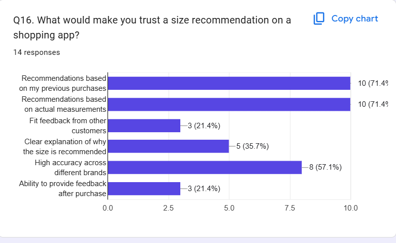

# Survey Findings — Exploratory User Research (V1)

## 1. Executive Summary & Sample Overview
- **Total Submissions:** $N = 16$
- **Qualified Analysis Sample ($n = 14$):** 14 respondents (87.5%) reported purchasing T-Shirts online in the past 6 months and completed the full 18-question survey. Two respondents answered "No" to recent online T-Shirt purchases and exited at screening.
- **Age Distribution ($n = 14$):**
  - **18–21:** 5 (35.7%)
  - **22–25:** 5 (35.7%)
  - **Below 18:** 3 (21.4%) *(sample eligibility deviation noted in `docs/02_research_plan_and_method.md`)*
  - **26–30:** 1 (7.1%)
- **Methodological Note:** All percentages below use **$n = 14$** as the denominator and are rounded to one decimal place. Because this is a small, non-probability convenience sample, findings represent directional product signals rather than market-wide estimates.

---

## 2. Current Size-Selection Behavior & Confidence (Q5–Q7)

### How Shoppers Usually Decide Which T-Shirt Size to Purchase (Q5 — Single-Select, $n = 14$)
| Usual Size-Selection Method | Count | Share |
|---|---:|---:|
| I select my usual size | 7 | **50.0%** |
| I check the size chart | 4 | **28.6%** |
| I use a size recommendation feature | 2 | **14.3%** |
| I guess based on product images | 1 | **7.1%** |

### Confidence vs. Fit Mismatch Frequency (Q6 & Q7 — $n = 14$)
- **Size Selection Confidence (Q6, 1–5 Scale):** `1`: 1 (7.1%) | `2`: 4 (28.6%) | `3`: 4 (28.6%) | `4`: 5 (35.7%) | `5`: 0 (0.0%) — **Mean = 2.93 / 5.0**. Zero respondents rated their confidence `5/5`, and **64.3% (9/14)** scored `3` or lower.
- **Received a T-Shirt That Did Not Fit as Expected (Q7):**
  - **Frequently:** 7 (50.0%)
  - **Sometimes:** 5 (35.7%)
  - **Rarely:** 2 (14.3%)
  - **Never:** 0 (0.0%)
  - **Combined Frequent/Occasional Mismatch:** **85.7% (12/14)**

---

## 3. Fit Friction, Returns & Coping Behaviors (Q8–Q11)

### Reported Fit Problems (Q8 — Multi-Select, $n = 14$) & Return History (Q9 — Single-Select, $n = 14$)
| Fit-Related Problem (Q8) | Count | Share |
|---|---:|---:|
| Size differed across brands | 9 | **64.3%** |
| Size chart was confusing | 7 | **50.0%** |
| T-Shirt was too loose | 5 | **35.7%** |
| Length was too long | 3 | **21.4%** |
| T-Shirt was too tight | 2 | **14.3%** |
| No fit-related problems | 2 | **14.3%** |
| Length was too short | 1 | **7.1%** |
| Sleeve fit was uncomfortable | 1 | **7.1%** |
| Shrinkage after wash | 1 | **7.1%** |

- **Size/Fit Return & Exchange History (Q9):** **100% of respondents (14/14)** have returned or exchanged a T-Shirt due to size or fit—**78.6% (11/14) *multiple times*** and **21.4% (3/14) *once***.

### Actions When Unsure About Size (Q10 — Multi-Select) & Existing Size Chart Utility (Q11 — 1–5 Scale)
| Coping Action When Unsure (Q10) | Count | Share |
|---|---:|---:|
| Check the size chart | 10 | **71.4%** |
| Read customer reviews | 9 | **64.3%** |
| Ask friends/family | 9 | **64.3%** |
| Avoid purchasing the product (abandonment) | 6 | **42.9%** |
| Order my usual size anyway | 3 | **21.4%** |
| Search for product details online | 1 | **7.1%** |
| Order multiple sizes (bracketing) | 1 | **7.1%** |

- **Usefulness of Existing Size Charts (Q11, 1–5 Scale):** `1`: 0 (0.0%) | `2`: 1 (7.1%) | `3`: 8 (57.1%) | `4`: 5 (35.7%) | `5`: 0 (0.0%) — **Mean = 3.29 / 5.0**. Most respondents view existing size charts as merely average (`3/5`), and **42.9% (6/14)** abandon purchases when unsure.

---

## 4. Core Challenge & Feature Discovery (Q12–Q13)

### Single Biggest Size-Selection Challenge (Q12 — Single-Select, $n = 14$)
- **Different sizing across brands:** **11 (78.6%)**
- **Uncertainty about how the T-Shirt will look on me:** **2 (14.3%)**
- **Lack of fit-related customer reviews:** **1 (7.1%)**

### Most Helpful Information When Selecting a Size (Q13 — Multi-Select, $n = 14$)
| Requested Information / Feature | Count | Share | Product Scope Mapping |
|---|---:|---:|---|
| Personalized size recommendation | 12 | **85.7%** | Core MVP Recommendation Engine |
| Visual representation of the expected fit | 9 | **64.3%** | Advanced / Future Scope (GenAI Simulation) |
| Clear indication: *Runs Small / True to Size / Runs Large* | 6 | **42.9%** | MVP / P1 Garment Ease Cue |
| Fit-related customer review summary | 6 | **42.9%** | Future NLP Summarization Module |
| Comparison with my usual size across brands | 5 | **35.7%** | P1 / Optional Authorized Purchase History |

---

## 5. Data Comfort, Explainability & Trust Drivers (Q14–Q16)

### Comfort Providing Personal Inputs (Q14 — Multi-Select, $n = 14$)
| Input Signal | Count | Share | UX & Data Governance Decision |
|---|---:|---:|---|
| Chest measurement | 11 | **78.6%** | Primary sizing anchor (with measurement guide) |
| Height | 10 | **71.4%** | Core input (supports garment length cue) |
| Fit preference (`Slim` / `Regular` / `Relaxed`) | 10 | **71.4%** | Core input (controls target garment ease) |
| Weight | 8 | **57.1%** | **Optional** (lower comfort; supplementary BMI only) |
| Previous purchase information | 4 | **28.6%** | **Strictly opt-in** (requires explicit permission) |
| My usual T-Shirt size | 3 | **21.4%** | Optional baseline reference |

### Usefulness of Recommendation Explanation (Q15 — 1–5 Scale, $n = 14$)
- **Distribution:** `1`: 0 (0.0%) | `2`: 0 (0.0%) | `3`: 2 (14.3%) | `4`: 4 (28.6%) | `5`: 8 (57.1%)
- **Descriptive Mean:** **4.43 / 5.0** — **85.7% (12/14)** rated recommendation explanations `4` or `5` out of 5.

### What Builds Trust in a Size Recommendation (Q16 — Multi-Select, $n = 14$)
| Trust Signal | Count | Share |
|---|---:|---:|
| Recommendations based on my previous purchases | 10 | **71.4%** |
| Recommendations based on actual measurements | 10 | **71.4%** |
| High accuracy across different brands | 8 | **57.1%** |
| Clear explanation of why the size is recommended | 5 | **35.7%** |
| Fit feedback from other customers | 3 | **21.4%** |
| Ability to provide feedback after purchase | 3 | **21.4%** |

---

## 6. Product Implications & Guardrails
1. **Anchor MVP in Actual Measurements + Transparent Rationale:** **71.4%** trust recommendations grounded in actual measurements, and **85.7%** rate explanations `4–5/5` (mean **4.43/5**). The MVP prioritizes deterministic garment-to-body matching with clear measurement explanations.
2. **Capture Fit Preference Explicitly:** **71.4%** are comfortable sharing fit preference (`Slim` / `Regular` / `Relaxed`), directly addressing the **35.7%** who reported T-Shirts arriving *too loose*.
3. **Keep Weight Optional & Purchase History Opt-In:** While **71.4%** trust purchase-history-informed recommendations, only **28.6%** are initially comfortable sharing purchase data (and **57.1%** for weight). Making weight optional and gating purchase history behind explicit consent balances trust with low onboarding friction.
4. **Stage Visual Fit Simulation as Post-MVP:** **64.3%** want a visual representation of expected fit, but generative visual accuracy carries high risk and must remain an optional, clearly labeled simulation after the core sizing engine is validated.

### Analytical Cautions
- Percentages are rounded to one decimal place against $n = 14$.
- Multi-select responses overlap and exceed 100% in aggregate.
- Survey findings validate user problem perception and feature interest; they do **not** prove production adoption, conversion lift, or return-rate reduction.
