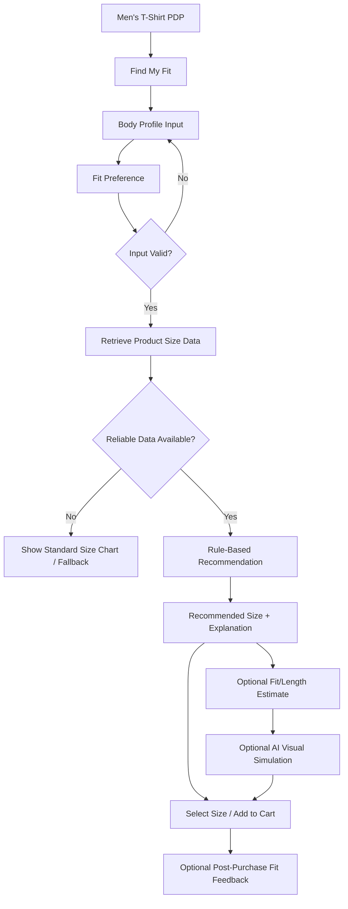

# User Journey & Flow

## Main journey
1. Shopper opens a Men's T-Shirt product detail page.
2. Shopper taps “Find My Fit”.
3. Shopper enters height and chest measurement; weight is optional.
4. Shopper selects Slim / Regular / Relaxed preference.
5. System validates input and units.
6. System checks product-specific size chart/garment measurements.
7. Recommendation engine returns a size (or safe fallback).
8. User sees recommendation and evidence-based explanation.
9. Product length/fit cues may appear if data supports them.
10. Optional advanced visual fit simulation may be requested.
11. Shopper chooses a size and proceeds to cart.
12. After purchase, user may provide fit feedback.

## Mermaid flow

## Key edge cases
- User doesn't know chest measurement → offer instructions and allow size chart fallback.
- Product dimensions absent → no recommendation; show chart.
- User is between sizes → apply documented ease rule and explain alternative.
- User declines purchase history → recommendation uses current profile and product data only.
- AI image generation fails → keep recommendation result available.
