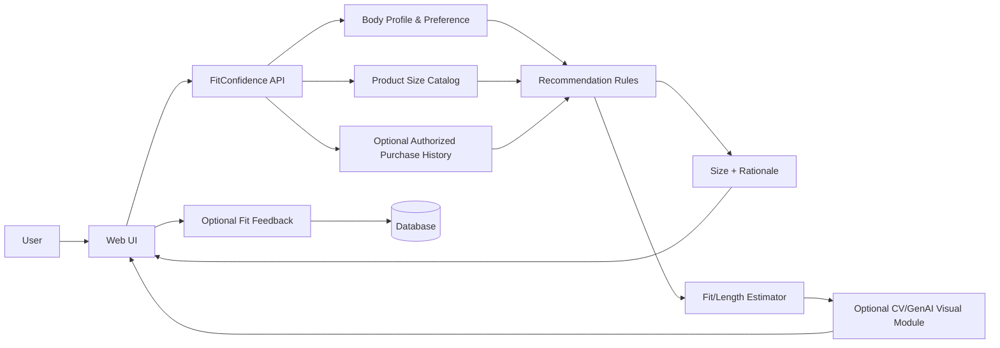

# Technical Feasibility & Proposed Architecture

## Prototype stack (proposal)
- Frontend: Next.js/React + TypeScript + Tailwind CSS
- API: Python FastAPI
- Recommendation logic: deterministic rules first; model-based methods only after evaluation data exists
- Database: PostgreSQL/Supabase for sample catalog, profile consent, and feedback
- CV experimentation: OpenCV/PyTorch, only with suitable datasets and clear evaluation
- GenAI images: image-generation API/model; optional non-blocking module
- Design: Figma

This is a proposed stack, not an implemented stack.

## Component feasibility
| Component | Approach | Prototype feasibility | Key dependency |
|---|---|---|---|
| Form inputs and unit conversion | Frontend validation | High | UI |
| BMI calculation | Simple formula; supplementary only | High | Height/weight |
| Size recommendation | Rules over garment dimensions | High for sample data | SKU/size measurements |
| Explanation | Template grounded in engine output | High | Output schema |
| Length cue | Defined heuristic | Medium | Height and garment length |
| Purchase history | Authorized integration/mock data | Medium/low without partner access | Permission and API/data access |
| Fit review summary | LLM/NLP summarization with source review | Medium | Fit reviews |
| CV fit estimation | CV model research | Low–medium | Training/validation data |
| GenAI visual simulation | Image-conditioned generation | Demo medium; accuracy hard | Product images and fit signals |

## Conceptual architecture

## Technical notes
- BMI = weight(kg) / height(m)^2, if values are provided; it is not a reliable direct garment-size predictor and should not drive sizing.
- Chest measurement should be a core input, while actual garment measurements and fit ease must be modeled separately.
- Product dimensions must be SKU/size-specific and sourced, not fabricated.
- CV/GenAI should not be represented as validated unless evaluated against real fit outcomes.
- Personal data should be minimized, secured, permissioned, and given retention/deletion controls.
